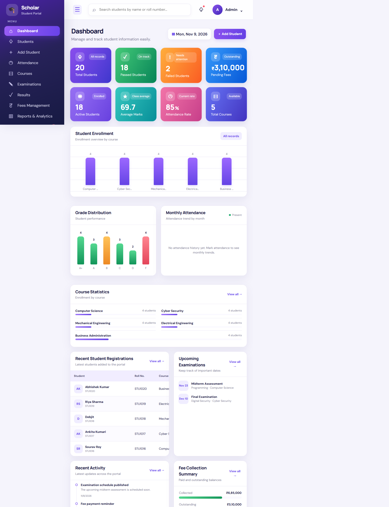
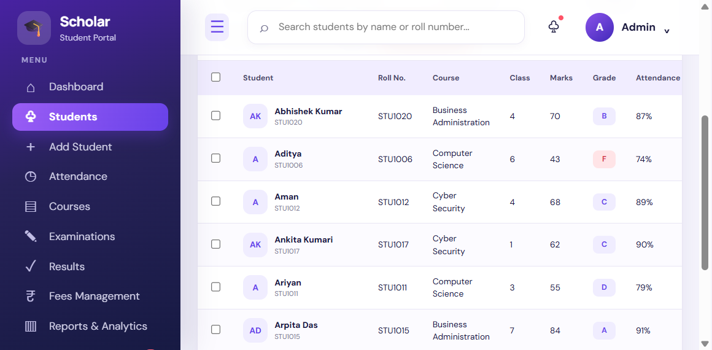
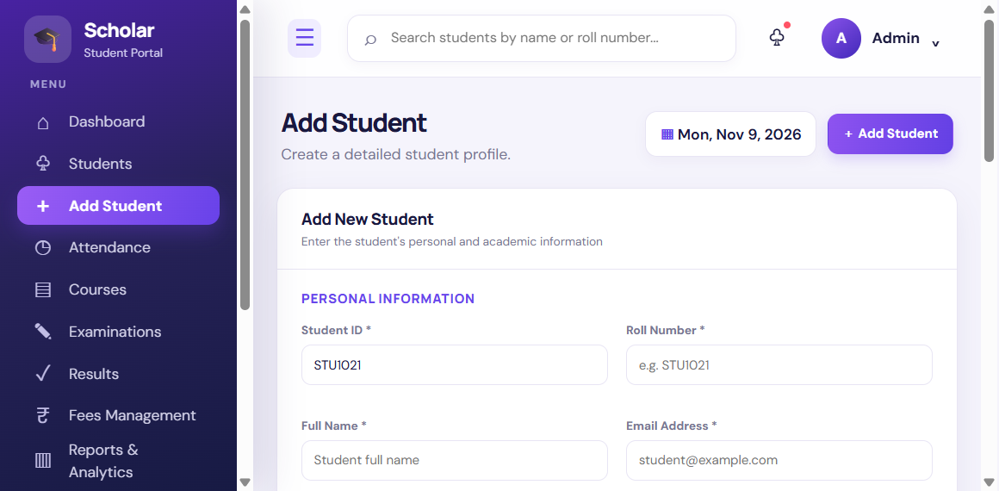
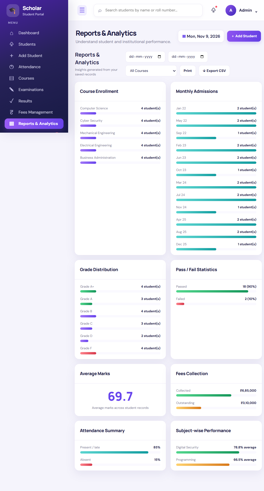
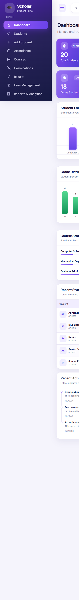

# Scholar — Student Management Portal

## 1. Project Title

**Scholar Student Management Portal** — a responsive, browser-based student administration application.

## 2. Project Objective

The objective is to provide a single, approachable interface for maintaining student records and reviewing related academic information. Scholar expands a student-management project into a set of connected workflows while keeping its implementation accessible through HTML, CSS, vanilla JavaScript, and browser storage.

## 3. Project Overview

Scholar has a purple dashboard and dedicated sections for student records, attendance, courses, examinations, results, fees, reports, notifications, and settings. The dashboard summarizes stored records using CSS-rendered charts and statistic cards. Users can add, view, edit, and remove students, record attendance and marks, manage fee payments, and print student-facing documents.

The application has no application server or remote database. Records and preferences are stored in the browser's LocalStorage. A separate static build script generates content-hashed asset URLs and a deployment version for the GitHub Pages Actions workflow. The app does not register a service worker.

## 4. Technologies Used

| Technology | Use |
|---|---|
| HTML5 | Semantic page structure, forms, tables, and navigation |
| CSS3 | Purple interface, responsive layouts, themes, animations, and CSS-rendered charts |
| Vanilla JavaScript (ES6+) | Data models, application workflows, validation, DOM updates, and browser interactions |
| LocalStorage | Browser-local persistence for students, attendance, courses, examinations, fees, notifications, and settings |
| Node.js built-in modules | Build-time asset hashing and automated build tests; no runtime package dependencies |
| GitHub Actions / GitHub Pages | Configured static-site test, build, and deployment workflow |

## 5. Main Features

- **Dashboard:** student and course totals, passed/failed counts, average marks, attendance rate, outstanding fees, enrollment and grade charts, course summaries, recent registrations/activity, and upcoming exams.
- **Student management:** create, view, edit, and delete student records; profile printing; required-field and Indian phone/email checks; duplicate student ID and roll-number prevention; search, filters, sorting, pagination, bulk deletion, CSV import, and CSV export.
- **Student details:** personal and academic fields include contact details, guardian information, course, semester, marks, attendance, status, and an optional profile photo URL.
- **Attendance:** mark present, absent, or late by date, course, and semester; mark a class present; review and filter history by student, date, and month; calculate attendance percentages.
- **Courses and departments:** add, edit, and delete course cards with department, duration, description, and enrollment information.
- **Examinations and results:** manage exams and subjects, enter marks, calculate percentages and grades, search results, determine pass status, and print result cards. The pass threshold is 40%; grades are A+ (90–100), A (80–89), B (70–79), C (60–69), D (50–59), and F (below 50).
- **Fees:** review totals and balances, add payments, inspect payment history and due status, and print receipts. Currency formatting uses INR.
- **Reports:** review enrollment, marks, grades, pass/fail, attendance, and fees with date/course filters, CSV export, and print.
- **Notifications and settings:** mark notifications read, manage institution/admin details, switch light/dark theme, import/export a validated JSON backup, and explicitly reset demonstration data.
- **Data protection and updates:** stored collections are checked when loaded; backup imports are validated. The deployment update check does not clear or migrate LocalStorage. As with any browser-only demo, LocalStorage is not a secure shared database.

## 6. Website Screenshots

These screenshots were captured from the running Scholar portal. Desktop pages use a wide viewport; the mobile screenshot uses the responsive layout.

### Dashboard



### Student management



### Add student form



### Reports and analytics



### Mobile dashboard



## 7. GitHub Repository Link

[Scholar Student Management Portal on GitHub](https://github.com/itsnandani/student-management-system/)

## 8. Live Website Link

[Open the live Scholar portal](https://itsnandani.github.io/student-management-system/)

## 9. Challenges Faced

- Keeping multiple data areas consistent while maintaining a browser-only architecture.
- Validating student data from both forms and CSV imports, including duplicate identifiers.
- Coordinating records when students or courses are edited or removed.
- Presenting useful reporting and dashboard visualizations without a chart framework or server.
- Making a multi-section dashboard usable at narrow viewport widths.
- Delivering current static assets on deployment without treating application records as disposable cache.

## 10. Solutions Implemented

- Organized persistence and feature behavior into focused JavaScript modules with a shared `DataStore`.
- Reused student validation rules and checked structured data when loading records or importing backups.
- Updated related attendance, fee, and examination records when a student is deleted; course changes are propagated to related records.
- Rendered dashboard and report visualizations from saved application data using CSS and DOM-generated markup.
- Used responsive CSS breakpoints, scrollable data tables, and a collapsible mobile sidebar.
- Added a build that hashes local CSS, JavaScript, and CSS-linked assets, and derives an application version. A version checker offers a refresh when a deployment changes. No service worker is used and asset updates do not erase LocalStorage.

## 11. Key Learnings

This project applies modular JavaScript, data validation, CRUD workflows, DOM rendering, event delegation, CSV and JSON file handling, LocalStorage persistence, responsive CSS, and static-site deployment practices. It also demonstrates the distinction between browser-cached files and application data: asset versioning can refresh deployed code while leaving saved records intact.

## 12. Future Improvements

- Add automated interaction tests for student, attendance, examination, and fee workflows.
- Add accessible chart alternatives and improve keyboard/screen-reader testing.
- Add a secure authenticated backend and role-based access if the portal is adapted for real institutional records.
- Add explicit, versioned data migrations if future application releases change the LocalStorage schema.

## 13. Installation and Setup

The application itself has no package installation step or third-party runtime dependency.

1. Clone the verified repository or download its source:

   ```sh
   git clone https://github.com/itsnandani/student-management-system.git
   cd student-management-system
   ```

2. To open the source directly, use a modern browser. For local server behavior, use VS Code Live Server or another static HTTP server.
3. Node.js 20 or newer is required only to run the optional static build and its tests.

## 14. How to Run the Project

- **Direct browser:** open `index.html`. The network-based deployment version check is skipped for `file://` URLs.
- **Local static server:** serve the project folder over HTTP and open its `index.html`.
- **Test and build the Pages artifact:** from the project root, run:

  ```sh
  node --test scripts/build.test.mjs
  node scripts/build.mjs
  ```

  The generated deployment site is written to `dist/`. Preview that directory using a static HTTP server. The build directory is ignored by Git and regenerated for deployment.

Use **Settings → Export backup** before moving browser data to another device. Clearing browser site data removes LocalStorage and is separate from refreshing application assets.

## 15. Git and GitHub Instructions

The local checkout is on branch `main` at `da4195c` (`Initial commit: Student Management System`). GitHub's `main` currently has a newer direct child commit, `e0327b54885916c28231c6bca129021fa97fe5a5`; fetch and review it before reconciling or committing local changes. View the actual remote history on [GitHub](https://github.com/itsnandani/student-management-system/commits/main/) or local history with `git log --oneline`. These workspace changes are not commits.

To prepare and push your own changes:

```sh
git status
git add README.md DOCUMENTATION_VALIDATION.md screenshots css js scripts .github index.html .gitignore
git commit -m "Prepare Week 6 student portal submission"
git push origin main
```

Review the staged file list before committing. Do not initialize a second repository or rewrite existing history.

## 16. GitHub Pages Deployment

The project includes `.github/workflows/pages.yml`, and the provided Pages URL was checked during this audit. The workflow:

1. Runs on pushes to `main` or manual dispatch.
2. Uses Node.js 20, runs the asset-versioning tests, builds the static site into `dist/`, and uploads that output for GitHub Pages deployment.
3. Uses the GitHub Pages Actions deployment job.

The latest remote run of `pages.yml` completed successfully for commit `e0327b5`, and its Pages deployment status is successful. A separate legacy workflow run was cancelled. The changes in this local workspace have not been committed or deployed. In GitHub, check **Settings → Pages** and select **GitHub Actions** as the source if deployment is not enabled.

## 17. Project Folder Structure

```text
Week5_Student_Management_System/
├── .github/
│   └── workflows/
│       └── pages.yml
├── assets/
│   └── README.txt                 # Reserved for local assets; none currently required
├── css/
│   └── style.css                  # Editable stylesheet
├── js/
│   ├── data.js                    # Sample data and LocalStorage/backup validation
│   ├── students.js                # Student model, CRUD, grades, and validation
│   ├── dashboard.js
│   ├── attendance.js
│   ├── courses.js
│   ├── examinations.js
│   ├── results.js
│   ├── fees.js
│   ├── reports.js
│   ├── notifications.js
│   ├── settings.js
│   ├── script.js                  # UI rendering, routing, and event wiring
│   └── version.js                 # Deployment version check and refresh notice
├── screenshots/
│   ├── dashboard.png
│   ├── students.png
│   ├── add-student.png
│   ├── reports.png
│   └── mobile.png
├── scripts/
│   ├── build.mjs                  # Static-site asset hashing and version generation
│   └── build.test.mjs
├── .gitignore
├── index.html
├── README.md
├── DOCUMENTATION_VALIDATION.md
└── dist/                          # Generated by the build; ignored by Git
```

The editable source files remain readable in `css/` and `js/`. The build generates content-hashed asset URLs and copies in `dist/`; it does not leave duplicate generated assets in the source folders.

## 18. Project Reflection

**Word count: 479**

I developed Scholar, a student management portal that brings student records, attendance, courses, examinations, results, fees, and reports into one responsive website. I selected this project because educational administration involves connected information that is difficult to manage consistently in separate lists. Building a browser-based system gave me a practical way to explore those relationships while extending an existing student project rather than starting with an unrelated template.

HTML helped me structure navigation, dashboard sections, accessible labels, forms, data tables, dialogs, and print-oriented result and receipt views. I used CSS to create the purple visual system, reusable cards, table states, light and dark themes, responsive grids, and mobile navigation. Media queries adapt the layout to smaller screens, while hover and focus styles improve interaction feedback. The dashboard charts are rendered with CSS and JavaScript from stored data; the project does not depend on a charting library.

JavaScript connects the page to focused data modules and handles CRUD operations for students, courses, examinations, attendance, and fees. I practiced DOM manipulation by rendering current records and summaries, and event handling through form submissions, delegated table actions, filters, navigation, and dialogs. Form validation checks required fields, email and Indian phone formats, mark and attendance ranges, and duplicate student identifiers. Search, sorting, filtering, pagination, CSV import, and CSV export make the student list more useful than a static table.

LocalStorage taught me to distinguish application data from downloaded assets. The portal stores student and related records, settings, and preferences in the current browser. Valid saved data is loaded instead of being replaced by demonstration data; backups provide an explicit way to move records. I added a build process that creates content-hashed CSS and JavaScript URLs and a deployment version check. Updating those files does not clear saved records. This remains a demonstration, not a secure shared database.

One challenge was keeping related records consistent when a student or course changes. I addressed it with shared models and explicit cleanup and rename operations. Another challenge was supporting a broader set of workflows without losing clarity on mobile. I addressed it with modular scripts, consistent forms and status indicators, and responsive CSS. During this audit I verified the existing `main` branch, its `origin` remote, and its actual commit history without rewriting any history. I also confirmed that the supplied repository and live Pages URL respond, but I did not push changes or claim a new deployment.

Through this work I learned to inspect an existing project before changing it, validate data at multiple entry points, and test actual browser behavior rather than infer it from code. I also checked the existing Git history and confirmed that the repository and live site respond; these changes remain uncommitted and undeployed. My next steps are to expand automated interaction tests, improve accessibility checks, and consider secure authenticated storage if real institutional data ever becomes a requirement.
